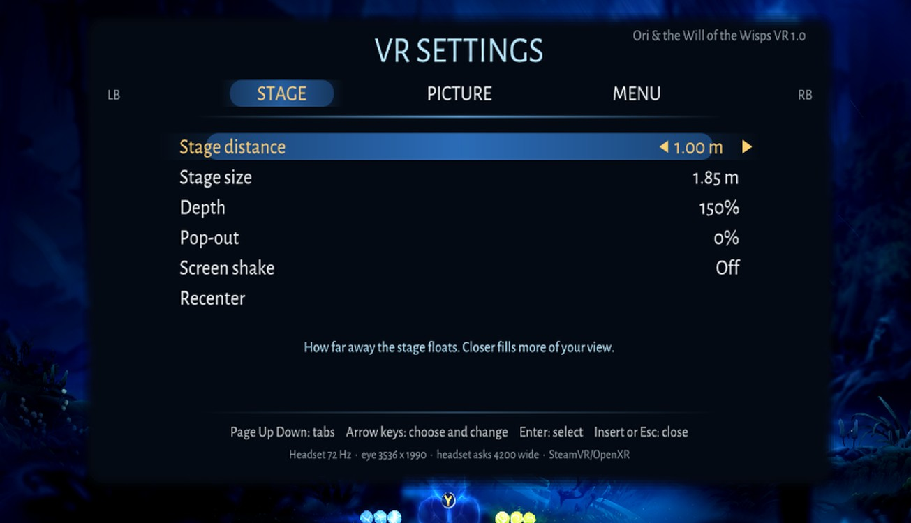
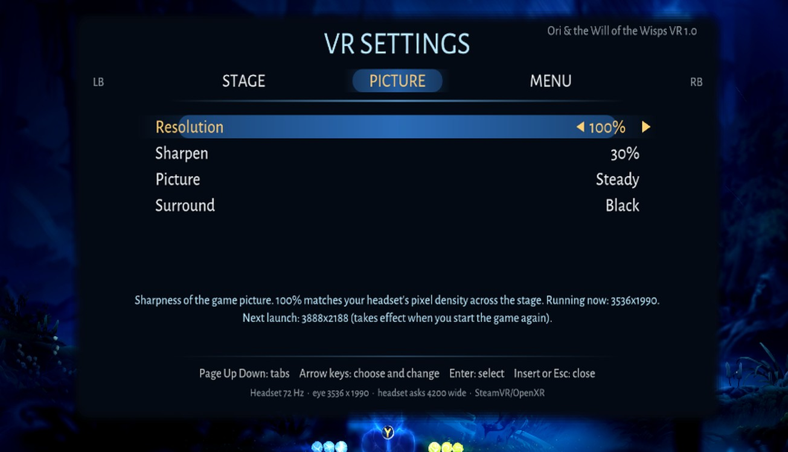
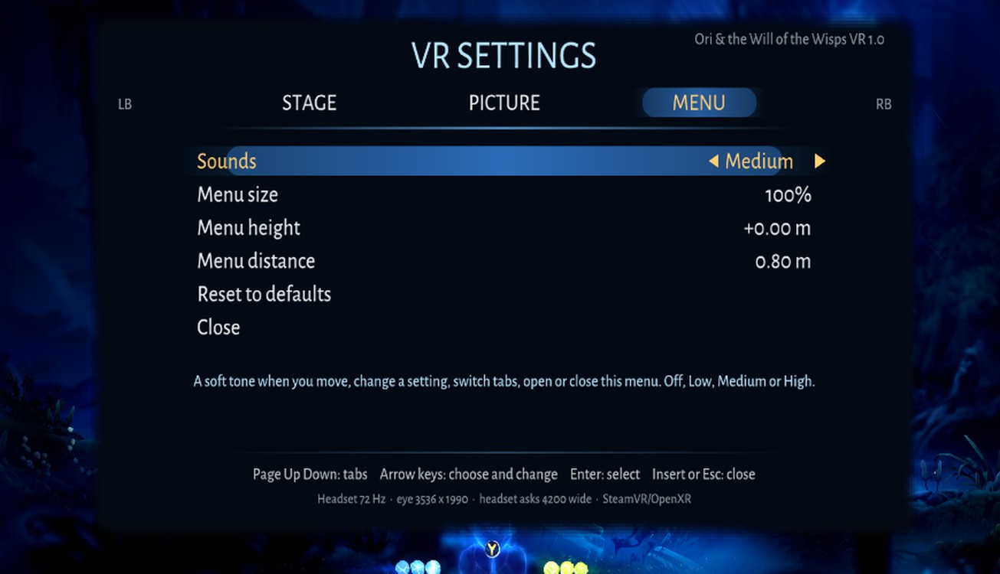

# Ori & the Will of the Wisps VR

True stereo VR for Ori and the Will of the Wisps. Both eyes are drawn from the same game tick, so there is no alternate-eye shimmer and no warping. The game becomes a diorama floating in front of you: its real depth layers stay real, so backgrounds sit behind the stage and the foreground comes out toward you. You play with a gamepad; there are no motion controls.

**Download:** see [Releases](../../releases).

**Support:** this mod is free. If you enjoy it, you can [buy me a coffee](https://buymeacoffee.com/scubasteve2365).

## What you need

- The Steam version of Ori and the Will of the Wisps
- A PC VR headset with an OpenXR runtime. Two have been tested:
  - SteamVR, set as your OpenXR runtime (SteamVR settings, OpenXR)
  - Virtual Desktop's VDXR, for headsets like the Meta Quest 3
- A gamepad (Xbox type; PlayStation pads through Steam Input)

## Install

1. Unzip the release anywhere.
2. Double click `Install OriWotWVR.bat` and type 1. It finds the game through Steam.
3. Start SteamVR or connect Virtual Desktop, then start the game from Steam. VR starts by itself.

To uninstall, run the same bat file and type 2. No game files are changed.

If another mod already uses `winhttp.dll` in the game folder (the randomizer does), the installer renames it to `winhttp_chain.dll` and this mod loads it first, so both keep working. Uninstall puts it back.

The mod is not signed, so Windows may warn you about the bat file. It is plain text, so you can read it first. Windows Smart App Control can block unsigned mod DLLs; if it is on and the game stays flat, that is the likely cause.

If the game stays flat for another reason, open the menu (hold both sticks, or press Insert). It tells you if VR did not start and why. If no OpenXR runtime is set and SteamVR is installed, the mod uses SteamVR for this game. Nothing on your PC is changed.

## Settings

Hold both sticks in for half a second to open the menu in the headset, or press Insert on the keyboard. The game pauses and gets no input while it is open. LB and RB (Page Up and Page Down) switch tabs, up and down choose a setting, left and right change it, A (Enter) selects and B (Esc) closes. Every row shows a short explanation at the bottom of the menu.

### Stage



| Setting | What it does |
|---|---|
| Stage distance, Stage size | Where the stage floats and how big it is |
| Depth | How strong the 3D is. Higher makes the world feel smaller and deeper |
| Pop-out | Brings more of the scene toward you, and eases far backgrounds |
| Screen shake | The game shakes the camera for bosses, thunder and big hits. In VR that shakes the whole stage, so it is Off by default |
| Recenter | Puts the stage in front of you again |

### Picture



| Setting | What it does |
|---|---|
| Resolution | 100% matches your headset's pixel density across the stage. Takes effect the next time you start the game |
| Sharpen | Crisper edges. Too high looks harsh |
| Picture | Auto picks Steady on Virtual Desktop and Floating Panel on everything else. Steady draws the stage into each eye's view and holds still under Virtual Desktop. Floating Panel can look a little sharper, but Virtual Desktop squashes and shears it when you turn your head |
| Surround | What you see around the stage. Black is the original look. Green fills it with pure green for Virtual Desktop's chroma-key passthrough, so your room shows around the game. Transparent asks your headset software to show your room itself, where it offers that, otherwise black |

### Menu



| Setting | What it does |
|---|---|
| Sounds | A soft tone when you move, change a setting or switch tabs. Off, Low, Medium or High |
| Menu size, height, distance | Where this menu floats. The stage does not change |
| Reset to defaults | Puts every setting back to how it started |
| Close | Closes the menu |

## Game settings

On first start the mod turns off the game's HDR, dynamic resolution and motion blur, and sets resolution scale 100% and graphics quality Balanced. While VR runs it keeps the game's VSync and frame limit off, because the mod paces the game to your headset. You can change the others back in the game's options.

## Performance tips

- **SteamVR throttling first.** In SteamVR Settings, Video, Per-application video settings, pick the game and set **Throttling Behavior** to **Fixed** at your headset's refresh rate, and turn **Motion Smoothing** off.
- **72 or 90 Hz is plenty.** Game speed holds at 72, 90 and 120 Hz.
- **Leave the game's VSync off.** It would tie the game to your desktop monitor instead of the headset.

## Good to know

- Screen shake is off, but a few other screen effects still move the picture. Defeating a boss plays a screen distortion effect that can feel disorienting. Future releases will hunt down more screen movement effects and turn them off.
- The mod keeps the game offline: it stops the game's online calls (PlayFab sign-in and telemetry), so Spirit Trials leaderboards do not work while it is installed.
- Closing the game can end with a Windows error report. The game does this on its own, without the mod too.
- The game's HUD sits on the stage.
- Tested in real headsets through SteamVR and on a Meta Quest 3 through Virtual Desktop's VDXR, on NVIDIA graphics. Other headsets and graphics cards should work through OpenXR but have not been tried. Reports are welcome.
- No DLSS or other upscaler; the game has none and does not need one.
- If something goes wrong, the log is `OriWotWVR.log` in the game folder. Please attach it to an issue.

## Support

This mod is free. If you enjoy it and want to support more VR mods, you can
[buy me a coffee](https://buymeacoffee.com/scubasteve2365). Thank you!

## Building from source

You need Visual Studio's C++ tools with CMake, the Khronos [OpenXR loader](https://github.com/KhronosGroup/OpenXR-SDK-Source/releases) for Windows, [MinHook](https://github.com/TsudaKageyu/minhook) source and [Dear ImGui](https://github.com/ocornut/imgui) 1.93.

```
cmake -S . -B out -A x64 -DOPENXR_DIR=<OpenXR loader folder> -DMINHOOK_DIR=<MinHook folder> -DIMGUI_DIR=<imgui folder> -DFONTS_DIR=<fonts folder>
cmake --build out --config Release
```

The output lands in `..\build`. `install\make_package.py` builds the release zip.

## Credits

Built with the Khronos [OpenXR loader](https://github.com/KhronosGroup/OpenXR-SDK-Source) (Apache-2.0), [MinHook](https://github.com/TsudaKageyu/minhook) (BSD-2) and [Dear ImGui](https://github.com/ocornut/imgui) (MIT). Fonts: Alegreya Sans and Marcellus SC (SIL OFL 1.1). The sharpening pass follows the idea of AMD FidelityFX Contrast Adaptive Sharpening (MIT). The way into the game follows the idea of the [Ori and the Will of the Wisps Randomizer](https://github.com/ori-community/wotw-rando-client) client (MIT); no code was copied. The diorama design comes from [Ori VR](https://github.com/scubasteve2365/OriVR) by the same author. Licences are in the release zip.

MIT licensed, by scubasteve2365. This is a fan mod, not made or approved by Moon Studios or Xbox Game Studios. It contains no game files.
